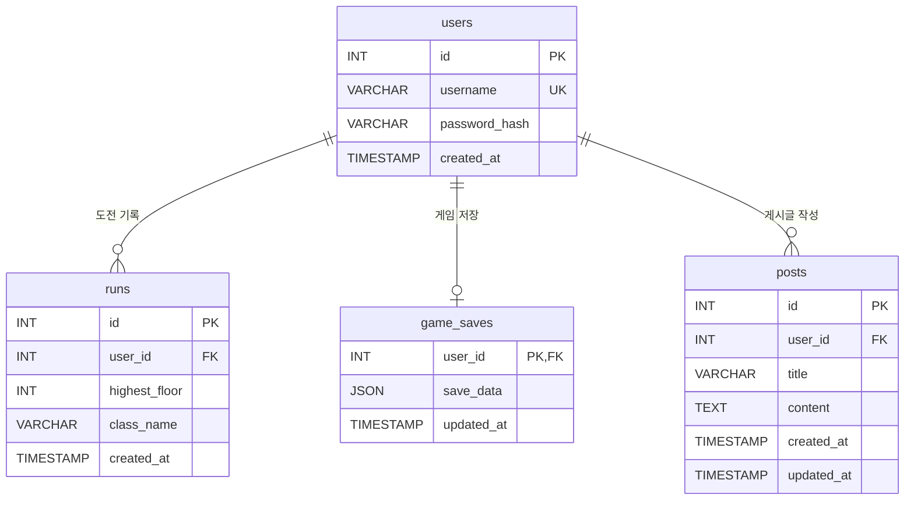

## 데이터베이스 설계

### 1. 데이터베이스 개요

본 프로젝트는 MySQL을 사용하여 사용자 계정, 게임 도전 기록, 게임 저장 데이터 및 커뮤니티 게시글을 관리한다.

모든 테이블은 InnoDB 스토리지 엔진과 utf8mb4 문자 인코딩을 사용하며, 사용자 고유 번호를 기준으로 각 테이블의 관계를 구성한다.

### 2. 테이블 구성

| 테이블명 | 설명 |
|---|---|
| users | 사용자 계정 정보 관리 |
| runs | 사용자의 게임 도전 기록 관리 |
| game_saves | 사용자의 현재 게임 진행 상태 저장 |
| posts | 커뮤니티 게시글 관리 |

### 3. 테이블별 컬럼 상세 설명

#### 3-1. users (사용자 계정)

회원가입, 로그인 및 사용자 인증에 필요한 계정 정보를 저장하는 테이블이다.

| 컬럼명 | 자료형 | 제약 조건 | 설명 |
|---|---|---|---|
| id | INT | PK, NOT NULL, AUTO_INCREMENT | 사용자를 구분하기 위한 고유 식별 번호 |
| username | VARCHAR(50) | NOT NULL, UNIQUE | 사용자의 로그인 아이디 |
| password_hash | VARCHAR(255) | NOT NULL | 사용자의 비밀번호를 해시 처리한 값 |
| created_at | TIMESTAMP | DEFAULT CURRENT_TIMESTAMP | 계정 생성 일시 |

사용자 아이디에 UNIQUE 제약 조건을 적용하여 중복 회원가입을 방지한다. 비밀번호는 평문이 아닌 해시값으로 저장한다.

#### 3-2. runs (게임 도전 기록)

사용자의 게임 도전 결과를 저장하며, 리더보드에서 순위 정보를 제공하기 위해 사용되는 테이블이다.

| 컬럼명 | 자료형 | 제약 조건 | 설명 |
|---|---|---|---|
| id | INT | PK, NOT NULL, AUTO_INCREMENT | 게임 도전 기록의 고유 식별 번호 |
| user_id | INT | FK, NOT NULL | 해당 기록을 등록한 사용자의 고유 번호 |
| highest_floor | INT | NOT NULL | 사용자가 클리어한 최고 층수 |
| class_name | VARCHAR(50) | NOT NULL | 해당 도전에서 사용한 클래스 정보 |
| created_at | TIMESTAMP | DEFAULT CURRENT_TIMESTAMP | 도전 기록이 생성된 일시 |

user_id는 users 테이블의 id를 참조한다. 사용자 계정이 삭제되면 해당 사용자의 도전 기록도 함께 삭제된다.

#### 3-3. game_saves (게임 진행 상태)

사용자의 현재 게임 진행 상태를 저장하는 테이블이다. 사용자가 게임을 종료하거나 페이지를 새로고침한 이후에도 저장된 데이터를 불러와 도전을 이어서 진행할 수 있도록 한다.

| 컬럼명 | 자료형 | 제약 조건 | 설명 |
|---|---|---|---|
| user_id | INT | PK, FK, NOT NULL | 저장 데이터를 소유한 사용자의 고유 번호 |
| save_data | JSON | NOT NULL | 플레이어 능력치, 층수, 골드, 몬스터, 패시브, 아이템 등 게임 진행 데이터 |
| updated_at | TIMESTAMP | DEFAULT CURRENT_TIMESTAMP, ON UPDATE CURRENT_TIMESTAMP | 게임 데이터가 마지막으로 저장 또는 수정된 일시 |

user_id를 기본 키와 외래 키로 동시에 사용하여 사용자 한 명당 하나의 게임 저장 데이터를 관리한다.

게임 진행 정보를 JSON 형태로 저장함으로써 다양한 게임 상태를 하나의 컬럼에서 관리할 수 있도록 설계하였다.

#### 3-4. posts (커뮤니티 게시글)

사용자가 커뮤니티에 작성한 게시글을 저장하고 관리하는 테이블이다.

| 컬럼명 | 자료형 | 제약 조건 | 설명 |
|---|---|---|---|
| id | INT | PK, NOT NULL, AUTO_INCREMENT | 게시글의 고유 식별 번호 |
| user_id | INT | FK, NOT NULL | 게시글을 작성한 사용자의 고유 번호 |
| title | VARCHAR(200) | NOT NULL | 게시글 제목 |
| content | TEXT | NOT NULL | 게시글 본문 |
| created_at | TIMESTAMP | DEFAULT CURRENT_TIMESTAMP | 게시글 작성 일시 |
| updated_at | TIMESTAMP | DEFAULT CURRENT_TIMESTAMP, ON UPDATE CURRENT_TIMESTAMP | 게시글의 마지막 수정 일시 |

user_id를 통해 게시글 작성자를 식별하며, 사용자 계정이 삭제되면 해당 사용자가 작성한 게시글도 함께 삭제된다.

### 4. 게임 저장 JSON 데이터 구조

game_saves 테이블의 save_data 컬럼은 다음과 같은 데이터를 포함한다.

| 속성명 | 데이터 유형 | 설명 |
|---|---|---|
| version | Number | 게임 저장 데이터의 버전 |
| phase | String | 전투, 보상 선택, 상점 이용 등의 현재 진행 단계 |
| floor | Number | 현재 도전 중인 탑의 층수 |
| classKey | String | 선택한 플레이어 클래스의 식별자 |
| player | Object | 플레이어의 기본 능력치, 현재 체력 및 초기 능력치 배분 정보 |
| enemy | Object | 현재 몬스터의 능력치 및 전투 상태 |
| gold | Number | 플레이어가 보유한 골드 |
| passives | Array | 구매한 클래스 전용 패시브 목록 |
| items | Object | 획득한 특수 아이템의 종류 및 보유 개수 |
| rewards | Array | 현재 선택할 수 있는 보상 목록 |
| rerollCount | Number | 현재 층에서 사용한 보상 리롤 횟수 |

### 5. 테이블 관계

| 기준 테이블 | 참조 테이블 | 관계 | 설명 |
|---|---|---|---|
| users | runs | 1:N | 한 명의 사용자가 여러 도전 기록을 가질 수 있음 |
| users | game_saves | 1:0..1 | 한 명의 사용자가 최대 하나의 게임 저장 데이터를 가질 수 있음 |
| users | posts | 1:N | 한 명의 사용자가 여러 게시글을 작성할 수 있음 |

모든 외래 키에 ON DELETE CASCADE를 적용하여 사용자 계정 삭제 시 관련 도전 기록, 게임 저장 데이터 및 게시글이 함께 삭제되도록 구성하였다. 이를 통해 데이터의 참조 무결성을 유지한다.

### 6. 주요 제약 조건

| 제약 조건 | 설명 |
|---|---|
| PRIMARY KEY | 각 레코드를 고유하게 식별 |
| FOREIGN KEY | 다른 테이블의 기본 키를 참조하여 데이터 간 관계를 형성 |
| NOT NULL | 해당 컬럼에 NULL 값이 저장되는 것을 방지 |
| UNIQUE | 동일한 값의 중복 저장을 방지 |
| AUTO_INCREMENT | 새로운 레코드 생성 시 식별 번호를 자동으로 증가 |
| DEFAULT CURRENT_TIMESTAMP | 별도의 값이 지정되지 않으면 현재 일시를 저장 |
| ON UPDATE CURRENT_TIMESTAMP | 레코드 변경 시 수정 일시를 자동으로 갱신 |
| ON DELETE CASCADE | 참조 대상 레코드가 삭제되면 관련 레코드도 함께 삭제 |

### 7. 데이터베이스 ERD

